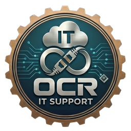

  

<h1 align="center">OCR Portapapeles</h1>

  Tus enlaces, contraseñas de wifi, direcciones, plantillas de correo o comandos de siempre,
  guardados junto a la hora de Windows: un clic y quedan en el portapapeles. 
  Un solo <code>.exe</code> de 400 KB, sin instalador, cifrado con tu contraseña.

  
  
  
  

---

## Para qué es

Hay textos que se escriben veinte veces al día: la URL del portal de un cliente, un número de
cuenta, la firma del correo, un comando de PowerShell, la dirección de envío. OCR Portapapeles
los guarda con un nombre corto y los deja a un clic desde la bandeja del sistema (los iconos de
al lado de la hora). Se pincha uno, se pega con **Ctrl+V** donde haga falta, y listo.

## Descarga

En [Releases](../../releases) está `OCRPortapapeles.exe`. Se copia donde se quiera y se
ejecuta; no se instala nada ni hace falta administrador. Cada release lleva el SHA-256 del
fichero.

El ejecutable **no va firmado** con certificado de código: SmartScreen puede avisar la primera
vez («Más información → Ejecutar de todas formas»). Comprueba el SHA-256 si tienes dudas.

## Cómo se usa

1. **La primera vez** pide crear una contraseña (mínimo 6 caracteres). Con ella se cifran los
   enlaces y se pide cada vez que se abre la app.
2. Aparece el icono junto a la hora (si no se ve, está dentro de la flecha **^** de iconos
   ocultos; se puede arrastrar fuera para tenerlo siempre a la vista).
3. **Clic en el icono** o **Ctrl+Alt+P** desde cualquier programa: sale el menú con los
   enlaces. Se pincha uno (o se elige con las flechas y Enter) y su texto queda copiado.
   Con el atajo, al copiar se vuelve a la ventana en la que estabas: basta con pulsar Ctrl+V.

### Crear y ordenar enlaces

- **Nuevo enlace…**: nombre (lo que se ve en el menú), grupo opcional y el texto, que puede
  tener varias líneas. Si ya había algo copiado, aparece rellenado.
- **Grupos**: los enlaces con el mismo grupo salen juntos en un submenú (Clientes, Correo,
  Comandos…).
- **Gestionar enlaces…**: editar, duplicar, subir, bajar y borrar. Doble clic para editar,
  Supr para borrar.

### Ajustes

| Opción | Qué hace |
|---|---|
| Atajo de teclado | Ctrl+Alt+P (por defecto), Ctrl+Mayús+Espacio, Ctrl+Mayús+V, Win+Alt+V o ninguno. Si otro programa ya usa la combinación, avisa. |
| Cambiar contraseña… | Pide la actual y vuelve a cifrar todo con la nueva. |
| Iniciar con Windows | Arranca sola al entrar en la sesión (sin administrador). |
| Abrir carpeta de datos | Abre la carpeta donde se guardan los enlaces. |

## Seguridad

- Los enlaces se guardan en `%APPDATA%\OCR IT Support\OCRPortapapeles\enlaces.dat`, cifrados
  con **AES-256** y firmados con **HMAC-SHA256**. La clave sale de tu contraseña con
  **PBKDF2-SHA256** (200.000 vueltas), así que probar contraseñas a ciegas es lento.
- La contraseña no se guarda en ningún sitio. Un fichero manipulado no se abre.
- **Si olvidas la contraseña, los enlaces no se pueden recuperar.** No hay puerta trasera.
- Lo que copias sí queda en el portapapeles de Windows como cualquier otro texto (y en su
  historial, si tienes activado Win+V).
- No se conecta a Internet ni envía nada a ningún sitio.

## Requisitos

Windows 10 u 11 (trae de serie el .NET Framework 4.8 que necesita). En Windows 7/8.1 funciona
si se instala .NET Framework 4.7.2 o posterior.

---

OCR IT Support

